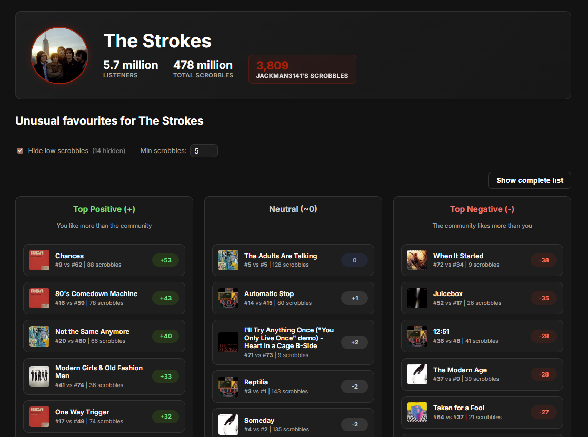
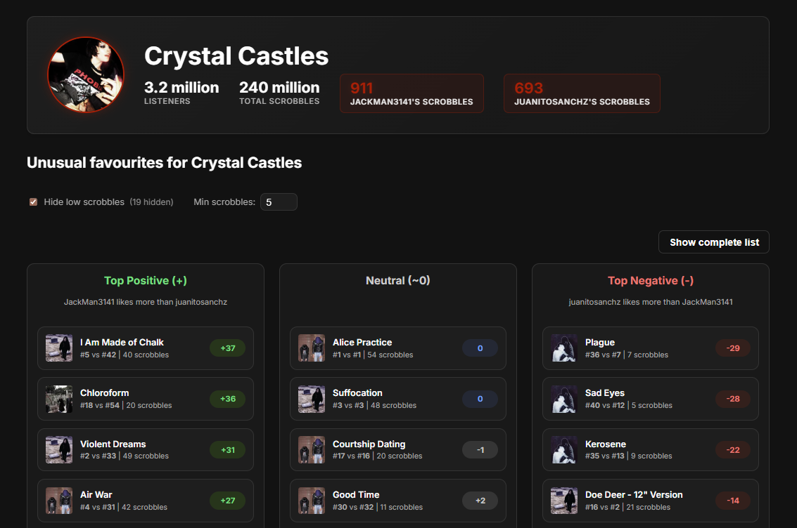

# Last.fm Comparator

Discover your "unusual favourites" for any artist by comparing scrobble histories.

## Features

- **Community Comparison** – Compare your personal play counts against the community's unique listener rankings to find tracks you love more (or less) than average.
- **User-to-User Comparison** – Compare your scrobble history directly with another Last.fm user to see where your tastes differ.

**Live site:** [scrobblegap.com](https://scrobblegap.com/)

### Community Comparison


### User-to-User Comparison


## Running Locally

1. **Install dependencies**
   ```bash
   npm install
   ```

2. **Start the server**
   ```bash
   npm start
   ```
   Or with auto-reload:
   ```bash
   npm run dev
   ```

3. **Open** `http://localhost:3000`

A bundled API key is included for convenience. Optionally, you can supply your own by copying `.env.example` to `.env` and filling in a key from [last.fm/api](https://www.last.fm/api/account/create).

## Caching Scrobbles (Optional)

When developing locally, you can pre-cache a user's scrobbles to skip slow API fetches:

```bash
node scripts/cache-scrobbles.js <username>
```

This downloads all scrobbles for the given user and saves them to `public/cache/<username>.json`. The app automatically loads cached data when running on localhost, making repeated artist comparisons instantaneous.